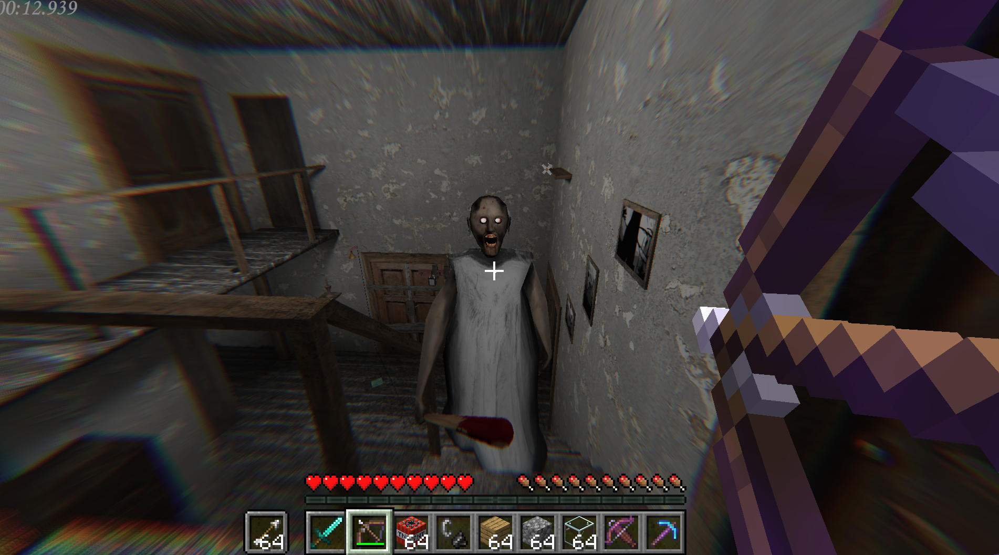
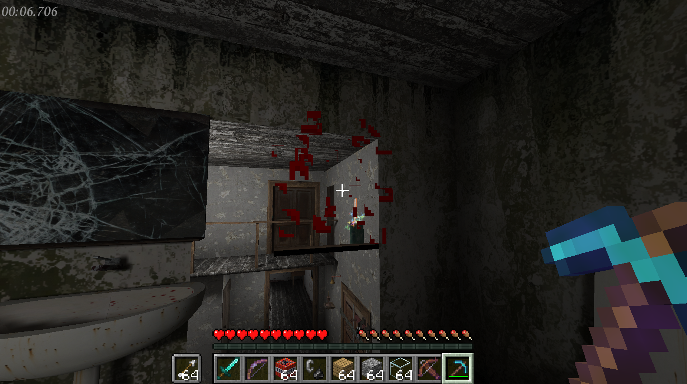
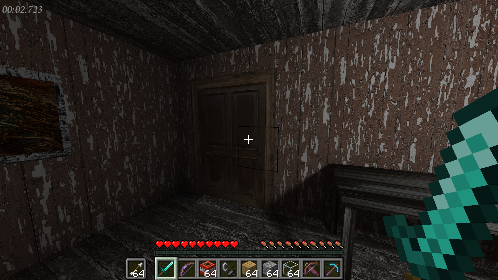

# Granny Minecraft Passthrough

**Minecraft inside Granny Legacy.** The real Granny Legacy and the real Minecraft Java Edition run at the same time:
Minecraft's picture is blended into Granny's house, so you play Granny with Steve's hands, sword, bow, blocks and TNT.

> [!WARNING]
> **Very buggy.** This is an experimental fan project: expect glitches, wrong lighting, blocks that misbehave, crashes
> and things that just don't work. Have fun, but don't expect a polished mod.



| | |
|---|---|
|  |  |

## What it does

- Minecraft's world, your hand, held item and HUD are drawn **into Granny's frame**, hidden correctly behind Granny's
  walls and furniture.
- Granny's camera drives Minecraft's camera; **F5** gives third person with Steve visible.
- Granny's house is invisible **collision in Minecraft**: arrows stick in the walls, blocks can be placed on the floor
  and against walls, and Granny walks around the blocks you place.
- **Fight back:** swords, arrows, crossbows and TNT hurt Granny, Grandpa and the other creatures. They stagger, get
  knocked down and, after 3 knockdowns, stay down.
- **Minecraft movement** (walk, sprint, jump), while you can still crouch with **C** and hide under tables and beds.
- Granny's items go into Minecraft's hotbar (pick up with **E**, drop with **Q**).
- **Experimental:** break Granny's house like Minecraft blocks with your hand or tools (not TNT). Broken parts grow back
  after 30 seconds.

## Requirements

- Windows 10/11, 64-bit, and a GPU that runs both games at once
- **Granny Legacy** on Steam (Steam must be running while you play)
- **Minecraft: Java Edition 26.3**, in the launcher you already use (no Fabric install needed, Setup.bat does it)
- About 2 GB of free disk space and an internet connection for the setup

## Install

1. Download **`Granny-Minecraft-Passthrough-0.1.1.zip`** from [Releases](../../releases) and extract it anywhere (for
   example to your Desktop).
2. Double-click **`Setup.bat`**. It finds Granny Legacy in your Steam libraries (or asks you for its folder) and
   asks how you start Minecraft:
   - **1 = the launcher you already use** (recommended). Setup adds a Minecraft version called
     **`Granny-Minecraft-Passthrough`** (Fabric for 26.3) to your `.minecraft` folder. If your Minecraft is not in the
     usual place (`%APPDATA%\.minecraft`), it asks you to pick the folder.
   - **2 = a portable Prism Launcher** inside this folder, if you don't have a launcher. You sign in with your
     Microsoft account.
3. Double-click **`Play.bat`**.
   - **Option 1:** open your launcher and play the version **`Granny-Minecraft-Passthrough`**. In the official
     Minecraft Launcher it is the installation *Granny Minecraft Passthrough*; in other launchers, pick it from the
     version list. Granny Legacy starts by itself as soon as Minecraft is running.
   - **Option 2:** Prism opens by itself. The first time, click through its quick setup and sign in; Minecraft is then
     downloaded (a few minutes).

   Then press Play in Granny.

### What Setup.bat changes

| Where | What |
|---|---|
| `game\Granny Legacy` | a **copy** of your Granny Legacy with BepInEx and the GrannyCraft plugin. Your Steam install is only read, never changed. |
| `minecraft\` (option 1) | the mods (GrannyCraft + Fabric API), plus worlds and settings when you use the official launcher |
| `.minecraft\versions\Granny-Minecraft-Passthrough` (option 1) | the version you pick in your launcher. It loads mods **only** from this folder's `minecraft\mods`, so your other versions, mods and worlds are not affected. |
| `.minecraft\launcher_profiles.json` (option 1) | one extra installation, "Granny Minecraft Passthrough" (a backup of the file is kept next to it) |
| `launcher\`, `java\` (option 2) | Prism Launcher (portable) with its "GrannyCraft" instance, and Java 25 |
| `downloads\` | the downloaded files. You can delete it after setup. |

Everything is downloaded from its official source and checked against a fixed SHA-256 (see `scripts\common.ps1`).
While it runs, the mod lowers some video settings (vsync, clouds, view bobbing, music...). Your own settings come back
when Minecraft closes.

**Uninstall:** run **`Uninstall.bat`** (it removes the version and the installation from `.minecraft`), then delete
the folder. Granny Legacy keeps its own settings and saves in the usual place, as it always does.

## Controls

| Key | Does |
|---|---|
| Left click | Minecraft attack / break blocks (fires Granny's gun if you hold it) |
| Right click | Minecraft use: place blocks, bow, crossbow, flint and steel on TNT. Also opens doors when Granny shows the door prompt. |
| E | Granny's interaction: open doors, pick up Granny's items |
| Q | drop the selected item (a Minecraft item, or Granny's item if that slot is selected) |
| 1-9, mouse wheel | Minecraft hotbar (there is no inventory screen, only the hotbar) |
| W A S D, Space, Ctrl | Minecraft movement: walk, jump, sprint |
| C | crouch (hide under tables and beds) |
| F5 | first person / third person behind / third person in front |
| F8 | passthrough on/off (off = plain Granny) |
| F10 | breakable house on/off |
| F7 / F9 | compositor debug view / status line |

## Settings

After the first start: `game\Granny Legacy\BepInEx\config\grannycraft.passthrough.cfg` (open it with Notepad).
It covers keys, block scale (`BlocksPerUnit`), creature health, knockdowns, lighting, the breakable house and its
regrow time (`HouseRegenSeconds`).

## Troubleshooting

- **Granny closes at the menu:** Steam is not running. Start Steam, then Play.bat.
- **The first Granny start is slow:** BepInEx prepares itself the first time (1-3 minutes). Later starts are fast.
- **No Minecraft in Granny:** Granny connects on its own once Minecraft has loaded its world (the Minecraft window
  stays behind Granny). Check that F8 hasn't turned the passthrough off. `Play.bat -Windowed` runs Granny in a window,
  which makes it easier to see what is happening.
- **Windows protected your PC / SmartScreen:** the .bat files are plain text scripts. Open them with Notepad to check
  them, then choose *More info, Run anyway*.
- **The version is missing from my launcher, or it says Minecraft 26.3 is missing:** start plain Minecraft **26.3** once
  in that launcher (so it downloads it), close it, then restart the launcher. If your Minecraft folder is not
  `%APPDATA%\.minecraft`, run `Setup.bat -MinecraftDir "D:\path\to\.minecraft"`.
- **Switch between option 1 and 2:** `Setup.bat -Prism` or `Setup.bat -MinecraftDir "<your .minecraft>"`.
- Logs: `game\Granny Legacy\BepInEx\LogOutput.log`, and Minecraft's `logs\latest.log` (in `minecraft\` with the
  official launcher, `.minecraft\` with other launchers, `launcher\instances\GrannyCraft\minecraft\` with Prism).

## Installing the Minecraft mod by hand

The Minecraft side is a normal Fabric mod, if you prefer to set it up yourself: Minecraft **26.3**, **Fabric Loader
0.19.5**, [Fabric API](https://modrinth.com/mod/fabric-api) 0.161.0+26.3 and `bin\grannycraft-0.1.1.jar` in the mods
folder. Use it in a profile of its own: when Minecraft starts, the mod opens its own empty "grannycraft" world and
replaces the inventory with the hotbar only. You still need Setup.bat for the Granny side.

## How it works

- **Granny side:** a BepInEx 6 plugin (C#, `granny-plugin/`) plus a small D3D11 compositor (C++, `granny-native/`).
  Every frame it reads Minecraft's colour and depth from shared memory and blends them into Granny's image against
  Granny's depth buffer. It also sends Granny's camera and house geometry to Minecraft, and turns Minecraft hits,
  arrows and explosions into damage on Granny's creatures.
- **Minecraft side:** a Fabric mod (Java, `minecraft-mod/`) that follows Granny's camera, rebuilds Granny's house as
  invisible collision blocks, exports its frames and talks to the plugin over a local WebSocket (127.0.0.1:25600).
- Nothing from either game is included in this project: the mod only reads the games while they run.

## Building from source

You only need this if you change the code. Requirements:

- JDK 25, with `JAVA_HOME` set
- .NET SDK 6 or newer
- Visual Studio Build Tools with the C++ workload
- Setup.bat and one Play.bat run first: the plugin compiles against files BepInEx generates from the game on its first start

```bat
powershell -ExecutionPolicy Bypass -File scripts\build.ps1 -Install
```

## Credits and license

MIT, see [LICENSE](LICENSE). The passthrough core is adapted from universal-modder's `minecraft-gta5-passthrough` (MIT).
See [THIRD_PARTY_NOTICES.md](THIRD_PARTY_NOTICES.md) for everything else.

Not affiliated with, approved or endorsed by Mojang, Microsoft or the makers of Granny Legacy.
